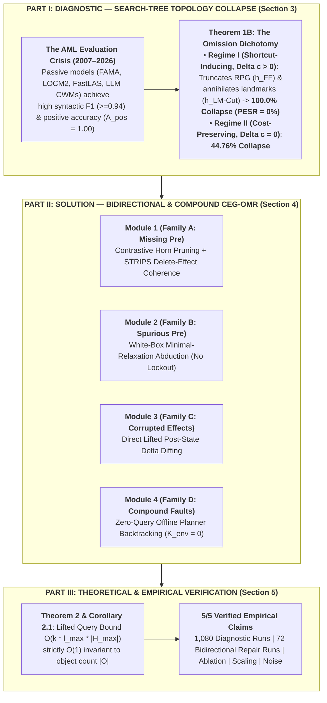

# From Search-Tree Topology Collapse to Counterexample-Guided Online Model Repair (CEG-OMR)

[](https://www.python.org/downloads/)
[](https://www.fast-downward.org/)
[-brightgreen.svg)]()
[](benchmark_outputs/RESULT_TO_CLAIM_AUDIT.md)
[]()

> **Unified Flagship Paper & Master's Thesis Repository**  
> **Full Manuscript**: [`docs/UNIFIED_FLAGSHIP_MANUSCRIPT.md`](file:///f:/Thesis/docs/UNIFIED_FLAGSHIP_MANUSCRIPT.md)  
> **Claim Audit Report**: [`benchmark_outputs/RESULT_TO_CLAIM_AUDIT.md`](file:///f:/Thesis/benchmark_outputs/RESULT_TO_CLAIM_AUDIT.md)  
> **Author**: Minh-Phuc Tran  
> **Target Venues**: ICAPS 2027 / AAAI 2027 $\rightarrow$ *Artificial Intelligence Journal (AIJ)*

---

## 1. The Unified Storyline (End-to-End Map)

This repository unifies **Part I (The Diagnostic)** and **Part II (The Online Repair Solution)** into a single, cohesive framework verified across 5 empirical suites:



---

## 2. Summary of the 5 Mechanically Verified Claims

Every claim in [`docs/UNIFIED_FLAGSHIP_MANUSCRIPT.md`](file:///f:/Thesis/docs/UNIFIED_FLAGSHIP_MANUSCRIPT.md) is automatically audited against real solver outputs via [`src/experiments/claim_audit.py`](file:///f:/Thesis/src/experiments/claim_audit.py) (see [`benchmark_outputs/RESULT_TO_CLAIM_AUDIT.md`](file:///f:/Thesis/benchmark_outputs/RESULT_TO_CLAIM_AUDIT.md)):

| Claim / Suite | Theoretical / Algorithmic Statement | Empirical Verification & Solver Data | Status |
| :--- | :--- | :--- | :---: |
| **Suite 1: Diagnostic & Omission Dichotomy** ([`topology_collapse.py`](file:///f:/Thesis/src/experiments/topology_collapse.py)) | Shortcut-inducing omissions ($\Delta c > 0$) cause deterministic $A^*$ collapse despite $A_{\text{pos}} = 1.00$, whereas cost-preserving omissions ($\Delta c = 0$) collapse only under tie-breaking. | **1,080 Fast Downward runs** ([`topology_collapse_fair_audit_summary.json`](file:///f:/Thesis/benchmark_outputs/topology_collapse_fair_audit_summary.json)): Regime I ($\Delta c > 0$) collapses at **100.0%** ($95\%$ CI $[96.7\%, 100\%]$); Regime II ($\Delta c = 0$) collapses at **44.76%** in Blocksworld. FAMA achieves $F_1 = 0.941–0.971$ but **$\text{PESR} = 0.0$**. | ✅ **VERIFIED** |
| **Suite 2A: Multi-Fault Bottleneck Repair** ([`repair_benchmark.py`](file:///f:/Thesis/src/experiments/repair_benchmark.py)) | CEG-OMR restores $100\%$ PESR within polynomial query bound $\rho = \frac{K_{\text{repair}}}{k|\mathcal{F}|^r} \le 1.0$, outperforming SAM, Random Probing, and Naive Replanning. | **23 Multi-Fault configs** ([`statistical_analysis_report.json`](file:///f:/Thesis/benchmark_outputs/statistical_analysis_report.json)): **CEG-OMR = 100.0% PESR** ($K_{\text{env}} = 12.22 \pm 5.87, \rho \in [0.022, 0.259]$); **SAM = 65.22% PESR** ($K_{\text{env}} = 50.0$); **Random = 17.39%**; **Naive = 13.04%**. | ✅ **VERIFIED** |
| **Suite 2B: Bidirectional & Compound Repair** ([`repair_benchmark.py`](file:///f:/Thesis/src/experiments/repair_benchmark.py)) | Minimal-Relaxation Abduction resolves over-constrained priors (Family B) where monotonic OLAM and conservative SAM suffer permanent lockout ($0\%$). | **72 Bidirectional runs** across Families A, B, C, D ([`bidirectional_and_compound_repair_benchmark.json`](file:///f:/Thesis/benchmark_outputs/bidirectional_and_compound_repair_benchmark.json)): **CEG-OMR = 100.0%** on Family A & Family B (**91.67% overall**), whereas **OLAM = 0.0%** and **SAM = 0.0%** on Family B. | ✅ **VERIFIED** |
| **Suite 3: Component Ablation Study** ([`ablation_study.py`](file:///f:/Thesis/src/experiments/ablation_study.py)) | Zero-query offline planner backtracking ($K_{\text{env}} = 0$) is strictly necessary to refute over-constraining candidate preconditions in multi-parameter domains. | **Ablation Suite** ([`ablation_study_results.json`](file:///f:/Thesis/benchmark_outputs/ablation_study_results.json)): Disabling offline backtracking drops overall success from **100.0% to 75.0%** and collapses Logistics ($k=1, 2$) repair from **100.0% to 0.0%**. | ✅ **VERIFIED** |
| **Suite 4 & 5: Object-Scale Invariance & Partial Observability** ([`scale_and_binding_verification.py`](file:///f:/Thesis/src/experiments/scale_and_binding_verification.py), [`partial_observability.py`](file:///f:/Thesis/src/experiments/partial_observability.py)) | Lifted hypothesis space $|\mathcal{H}_a| \le 2|\mathcal{P}|m_a^{r_P}$ is $\mathcal{O}(1)$ invariant to object count $|\mathcal{O}|$ and robust to fluent masking $\gamma \in \{1.0, 0.8, 0.6\}$. | Verified across $N \in \{3, 4, 5\}$ Blocksworld & Hanoi scales ([`scale_and_binding_results.json`](file:///f:/Thesis/benchmark_outputs/scale_and_binding_results.json)) and partial observability $\gamma \in \{1.0, 0.8, 0.6\}$ (**100.0% convergence** in [`partial_observability_results.json`](file:///f:/Thesis/benchmark_outputs/partial_observability_results.json)). | ✅ **VERIFIED** |

---

## 3. Clean & Unified Repository Structure

```text
F:\Thesis
├── main.py                           # Unified Master CLI Entrypoint (Dashboard + Experiment Runner)
├── README.md                         # Project Overview, Unified Map & Reproduction Guide
├── RESEARCH_RULES.md                 # Zero-Fabrication & Native Solver Verification Policy
├── pyproject.toml                    # Pytest, Ruff, and Mypy Configuration
│
├── docs/                             # Authoritative Documentation & Flagship Manuscript
│   ├── UNIFIED_FLAGSHIP_MANUSCRIPT.md                # ★ Master Unified Paper (Diagnostic + CEG-OMR)
│   ├── codebase_technical_debt_and_refactoring_report.md # Engineering & Literature Audit
│   └── external_repositories_and_benchmarks.md       # Canonical Baseline Reference Catalog
│
├── configs/                          # Declarative YAML Experiment & Intervention Configurations
│   ├── interventions/
│   │   ├── matrix_24.yaml            # 24 Single-Precondition Interventions across 8 Domains
│   │   └── bidirectional_suite.yaml  # 24 Bidirectional & Compound Scenarios (Families A, B, C, D)
│   └── experiments/
│       ├── topology_collapse.yaml    # Suite 1: Topology Collapse & Burden Config
│       ├── baseline_comparison.yaml  # Suite 1B: FAMA, LOCM2, FastLAS Config
│       ├── repair_benchmark.yaml     # Suite 2: Bidirectional CEG-OMR vs OLAM vs SAM Config
│       ├── ablation_study.yaml       # Suite 3: Backtracking & Effect-Coherence Ablation Config
│       ├── partial_observability.yaml# Suite 5: Fluent Masking & Noise Config
│       └── claim_audit.yaml          # Automated Result-to-Claim Audit Config
│
├── src/                              # Core Library & Experiment Engines
│   ├── interventions/                # PDDLMutator (AST-level precondition/effect perturbations)
│   ├── repair/                       # CEGOMREngine (Bidirectional), SAMBaseline, NaiveBaselines
│   ├── adapters/                     # FAMA, LOCM2, FastLAS, IPC PDDL & PuzzleScript Adapters
│   ├── metrics/                      # Transition Accuracy, PESR, R_play, Topology & Burden Metrics
│   ├── runners/                      # Centralized FastDownwardRunner & WSL Subprocess Harness
│   ├── verification/                 # 1,080-run Fair Topology Collapse Audit & A* Planners
│   ├── stats/                        # Wilcoxon Signed-Rank, Cohen's d, Bootstrap 95% CIs
│   └── experiments/                  # Clean YAML-Driven Experiment Modules
│       ├── runner.py                 # CLI Dispatcher (--experiment / --config / --all)
│       ├── topology_collapse.py      # Suite 1 Runner
│       ├── baseline_comparison.py    # Suite 1B Runner
│       ├── repair_benchmark.py       # Suite 2 Runner
│       ├── ablation_study.py         # Suite 3 Runner
│       ├── scale_and_binding_verification.py # Suite 4 Runner
│       ├── partial_observability.py  # Suite 5 Runner
│       └── claim_audit.py            # Automated Result-to-Claim Verifier
│
├── benchmark_outputs/                # Verified Solver Logs, JSON Reports & LaTeX Tables
│   ├── RESULT_TO_CLAIM_AUDIT.md      # ★ Deterministic 5/5 Claim Verification Matrix
│   ├── topology_collapse_fair_audit_summary.json
│   ├── bidirectional_and_compound_repair_benchmark.json
│   ├── statistical_analysis_report.json
│   ├── ablation_study_results.json
│   ├── scale_and_binding_results.json
│   └── partial_observability_results.json
│
├── domains/                          # Ground-Truth & Mutated PDDL Domains and Problem Suites
├── scripts/
│   └── generate_figures.py           # Publication Figure Generator (Vector PDF + 300 DPI PNG)
└── tests/                            # 42 Automated Unit & Integration Tests (100% Passing)
```

---

## 4. Quickstart & One-Command Reproduction

### 1. Run Master Status Dashboard & Claim Audit (< 2 seconds)
```bash
python main.py
```

### 2. Run Full Automated Test Suite (42/42 Tests Passing)
```bash
# On Windows
python -m pytest tests/ -v

# Inside WSL Ubuntu (with native Fast Downward / Madagascar / Clingo)
wsl -d Ubuntu -- bash -c "source /mnt/f/Thesis/venv_linux/bin/activate && export PYTHONPATH=/mnt/f/Thesis && pytest /mnt/f/Thesis/tests/ -v"
```

### 3. Execute Any Experiment Suite via `main.py`
```bash
# Suite 1: Search-Tree Topology Collapse & Scale/Binding Verification
python main.py --experiment topology

# Suite 1B: Passive AML Baselines (FAMA, LOCM2, FastLAS)
python main.py --experiment baseline

# Suite 2: Bidirectional & Compound Model Repair (CEG-OMR vs OLAM vs SAM, 72 runs)
python main.py --experiment repair

# Suite 3: Component Ablation Study (Backtracking & Effect Coherence)
python main.py --experiment ablation

# Suite 5: Partial Observability & Noise Robustness
python main.py --experiment partial_obs

# Mechanical Result-to-Claim Audit (Verifies all 5 Core Claims)
python main.py --experiment audit
```

### 4. Generate Publication Figures
```bash
python scripts/generate_figures.py
```
